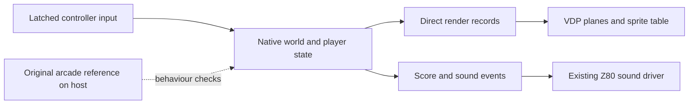

Mainstream update,21November2026: the user selected the compact collector as
`dist/Pac-Land-MD.bin`. A default rebuild is byte-identical to that candidate;
older 'distribution unchanged' statements below are historical. Sustained60NTSC
remains open. Crowded ghost scenes on return trips and later layouts are the
next reported hotspot (PERF-05); logs are acceptable to the user.

---

# Compact draw collector follow-up — 21 November 2026

The current separate candidate is `build/blast-collector/Pac-Land-MD.bin`,
SHA256 `373FA2E606024482A38A05FAD79674E4282D1CE1574D15308B079CAA529B7ED5`.
Use the same native/short/window flags below and this output directory.
The regular distribution is unchanged and a fresh flag-free rebuild matches it.

Scene candidates now store 16-bit slot offsets. A dedicated collector emits
four-byte draw commands directly, preserving priority order, list capacity,
wrapped-X visibility, hidden slots and native Pac-Man omission. Its C reference
remains available for differential checks. No gameplay kernels changed.

The matching warm NTSC log fixture improves from 75 to 83 completed
presentations in 89 active frames: **50.6 -> 56.0 FPS**, a 10.7% gain.
Round 2 remains60FPS. Longest held run falls from two display frames to one.
A separate equal-work24-frame trace reduces object-adapter ticks by10.9%,
from18.1% to16.2% of total elapsed samples; it still has24updates/21draws.

The normal controller-driven return completes at54.94FPS over1422active
frames, versus54.85 previously. This broader gain is small. The short matrix
records R3 56 (previous55), R25 59 (58), and R11 53 (54); other long-enough
fixtures are unchanged. Sustained60NTSC remains a release blocker.

256 independent boundary/capacity/priority fixtures pass for both C and assembly,
as do128all-layout composed sprite-pixel comparisons,120live SAT comparisons,
gameplay10/10,64endings, door/title/right-edge
checks, NTSC/PAL simulation pacing and12attract cycles. Candidate-list storage
saves96bytes; the attract heap remains5166. The latest handoff and source snapshot record the final checks.

An additional biased-X command experiment passed boundaries but reduced the
log cadence to53.3FPS; it was rejected and the better source restored.
Current evidence uses the `blast-collector-*` prefix. The detailed checkpoint
below describes its preceding native engine and retained architectural limits.

---

# Project Blast Processing

21 November 2026. Shared native systems now run across all 32 original layouts.
The NTSC performance gain is substantial; sustained 60 FPS is still an open
release gate. The user has explicitly deprioritized PAL performance.

## Current experimental cartridge

`build/blast-final-wide/Pac-Land-MD.bin`, 4,194,304 bytes, SHA256:
`7B2A41363E68436C0F23C6536392BEDBF97BC2F8DF8A3A863D99F9361E307EB6`.
Build with `PL_BLAST=1`, `PL_BLAST_SHORT=1`, `PL_BLAST_WINDOW=1`, and
`PL_OUTPUT_DIR=build/blast-final-wide`, using `tools/build.mjs` and the existing
Windows import hook. Hard-reset when switching cartridges. This is a separate
experimental ROM; the builder refuses `dist` for native experiments.

The regular cartridge is unchanged. A fresh flag-free rebuild in
`build/blast-normal-rebuild` matches its SHA256 byte for byte:
`901FDFB94E15F87F470D39F5216D8FF7D2E221E0ACF37240008EC52B53CEE0DC`.
Experimental `_etext` ends at 0x003F9D30, with limited ROM room remaining.

## Kept changes

- Native player walking/riding, air movement, terrain and flying boots;
  12-part bridges, paired three-part logs, frightened-car states 0 and 2–9,
  and ordinary fruit/hidden-item timers/contact. Selection applies to every
  original layout. Unsupported actor states, special launches, death and
  endings retain whole original handlers. This is shared-system coverage,
  not a rewrite of every NPC or a fully independent native world.
- The ordered activation plan uses 24-byte records. Exact world-X bounds skip
  runs of up to eight inactive static solids, while idle particle types use
  their original active gate before entering the compatibility ABI. Original
  interaction order and offscreen side effects remain observable.
- Native helpers explicitly produce SPAWN_GATE at R6[0x2016]. The original
  spawner reads this byte; the angle routine even has a third, otherwise
  unused fall-through conversion. Preserving that effect fixes the former
  round-14 divergence. Tests compare this byte rather than masking it.
- Per-round resident art plans cover 1,547 keys and 80–636 VRAM tiles per
  scene, leaving at least 144 tiles for streaming. A hashed original-engine
  census selects frequent art, with required regional caps, platforms and
  frightened-car animation phases. Plans reuse existing ROM bitmap data.
  Out-of-plan art retains the streaming fallback.
- Four-byte draw commands replace eight-byte pointer commands in this path.
  Native producers own their dirty render descriptors. A two-frame player
  VRAM cache also retains alternating body frames, with frame, palette,
  artwork and proportion in its tags. It does not change cap/boot colours.
- A bounded NTSC early-VBlank window can publish a small already-prepared
  queue when the blank has just begun. It requires V counter 224–230,
  at most 2,048 bytes and 32 DMA operations, once per interrupt, ordinary
  gameplay only. Cold/large scenes wait for a fresh blank. PAL uses ordinary
  drawing and never takes this window.

SGDK's default waits for the next blank start; ON_VBLANK can use the current
blank ([sys.c](https://raw.githubusercontent.com/Stephane-D/SGDK/master/src/sys.c),
[sys.h](https://raw.githubusercontent.com/Stephane-D/SGDK/master/inc/sys.h)).
The isolated maximum-load probe transfers all 32 operations / 2,048 bytes
correctly, empties the queue and exits at V counter 247–250. Gameplay stress
checks record zero window overruns. This is emulator timing evidence; physical
console validation remains open. `tests/vblank_window.mjs` uses a separate
`PL_BLAST_PROBE=1` cartridge. CPU-only pure calls cannot test raster timing.

## Comparable NTSC performance

Both warm fixtures import the same arcade state, settle caches for 16 display
frames with simulation frozen, then restore that state and resume tick-driven
inputs. Active statistics stop before death. The new counter measures completed
presentations after transfer; the regular build exposes prepared draws. These
short fixtures are not a sustained 2,000-active-frame release pass.

| Fixture | Regular distribution | Current native candidate |
| --- | ---: | ---: |
| Round 2, X2700/Y96 | 56/112 active frames, 30 FPS | 110/110, **60 FPS** |
| Round 4 logs, X2752/Y144 | 38/90, 25.3 FPS | 75/89, **50.6 FPS** |

Both candidate replays execute 120 simulation updates in 120 NTSC display
frames. These are roughly twice the previous presentation rates, while the
round-4 scene still holds some images for two display frames.
Evidence: `build/blast-final-wide-r{2,4}.json`, corresponding warm baseline
reports, and `build/blast-final-wide-busy-matrix.json`.

The eight-case matrix also records round 1 at 60, round 3 at 55, round 11 at
54, round 25 at 58, and round 27 at 59 FPS. The round-9 fixture dies after only
five active frames, so its 36 FPS is too short to characterize that layout.
The matrix has no arcade traps or early-window overruns.

An isolated common-state CPU benchmark needs 503 display periods for 2,000
updates versus 645 for the distribution (~22% less elapsed component time).
The activation plan alone reduced the preceding native version from 545 to
503 (~7.7%). Neither number is a gameplay FPS measurement; normal death drivers
and rendering are absent. Evidence: `build/blast-distribution-cpu.json`.

An earlier controller-only outward attempt traversed rounds 1–3, reached the
princess/boots and entered round 4, then ran out of lives: 57.5 FPS over 4,760
active frames. A separate stage-selected round-4 run completed the normal
return home into round 5: 55.7 FPS over 1,342 active frames, with ordinary deaths
and respawns. These used earlier native checkpoints and a simple input policy;
they neither establish sustained 60 FPS nor complete an uninterrupted first
trip. No coordinates, invincibility or enemies were changed within those
routes. See `blast-route-attempt1.json` and `blast-return-route.json` in build.

The final candidate also completes a stage-selected ordinary round-4 return:
1,422 active frames at 54.9 FPS, versus 1,382 at 52.7 FPS for the distribution
under the same controller policy. Both start with nine lives and reach round 5
with five. Inputs react to display-time state, so trajectories differ and this
is not an identical per-update replay. The broader route gain is modest; the
large improvement is concentrated in the heavy log fixture. Evidence:
`build/blast-final-wide-return-route.json` and
`build/blast-distribution-return-route.json`.

A new uninterrupted 24-frame trace of this candidate has 24 updates and 21
draws. Exclusive attribution: native world 25.0%, retained model 13.2%, object
adapter/draw 18.1%, planes/player/HUD 7.5%, display waiting 23.1%, remaining
wrapper/audio/SDK 13.1%. This is a separate held-input trajectory, not the
warm tick-driven FPS replay. Native plan dispatch alone is about 5.6% of the
trace, bridges 4.6%, cars 4.0%; rendering still deserves structural work.
Evidence: `build/blast-final-wide/active-r4-ntsc-u-budget.json`. These shares
are exclusive elapsed samples, not inclusive worst-case costs.

## Correctness and remaining work

The host comparison passes 76,800 updates over all 32 layouts with native
selection everywhere, preserving object/player/world state, bank and sound
requests. Independent 6809 interpretation passes 2,304 cases, including
fixed-point carry/phase boundaries, bridges and logs, player movement, fruit
and frightened cars. Emulated stack and documented helper scratch are excluded;
SPAWN_GATE is explicitly included. The old fruit state-2 shortcut omitted an
original fall-through. The experimental path and oracle use the original table;
its separate production fix is tracked as LOGIC-01.

Final cartridge, pixel, colour, gameplay, cutscene, menu and attract results are
recorded in the latest handoff and ISSUES.md. All tests operate on private
artifacts. Randomiser unions still use the streaming fallback where art is not
resident; a complete randomiser/full-route/hardware qualification remains open.

The next performance pass should profile the current mixed native/reference
path and rendering at ordinary slow-route positions. Replace a measured hot
family or adapter boundary as a whole, with an explicit event contract and
reference checks. Keep the full-rate NTSC gate and presentation counter; do
not promote an average near 60 as sustained 60. PAL functionality stays covered,
but PAL performance is not a release blocker under the latest user instruction.

Rejected experiments: ordinary-ABI C dispatch worsened cadence; linked-SAT
writers offered no improvement and diverged in a draw comparison; packed
position-word arithmetic was slower. Their production code was removed.
Historical prototypes/ROMs remain separate for evidence. There is no promotion
to the regular playable distribution in this checkpoint.

## Historical investigation and proposed architecture

The following evidence and original budget describe the earlier investigation.
Its round-4-only restriction and dual NTSC/PAL performance gate have been
superseded above by the authorized 32-layout rollout and NTSC priority.

## Decision

Build a native gameplay/object engine for one demanding section, paired with
direct VDP render records. Prove that section at full display cadence before
converting the remaining game. Keep the original arcade implementation as a
behavioural reference and initially retain cold sequences behind explicit
scene-boundary adapters.

The earlier optimisation work kept the arcade register/stack/RAM contract
inside each object routine. Even hand-written native functions still carry
that contract. Replacing more leaves under that same contract has diminishing
returns. The next unit of work is a complete gameplay subsystem with a native
data contract, rather than another translated instruction sequence.

## Fresh evidence

A separate diagnostic cartridge can disable major layers. All variants start
from the same full emulator snapshot, after the same round-4 log fixture and
five settling frames. Inputs follow the observed update count. Each runs for
80 display frames; active statistics stop before death state 8.

| Diagnostic variant | NTSC completed loops / active frames | PAL completed loops / active frames |
| --- | ---: | ---: |
| Full lab build | 38 / 80 | 37 / 74 |
| Entire renderer removed | 40 / 80 | 73 / 73 |
| Object drawing removed | 40 / 80 | 42 / 73 |
| HUD removed | 39 / 80 | 37 / 74 |
| Arcade frame update removed, world frozen | 80 / 80 | 80 / 80 |

These are **ablation ceilings, not optimisations**. A loop without rendering is
not an FPS measurement. Removing the arcade frame freezes object movement,
changes the world workload and still leaves IRQ/wrapper work. Removing drawing
also changes when inputs are sampled; snapshots share the starting state, not
an identical subsequent trajectory. Do not add these differences together.
This warmer fixture differs from the existing release replay, so its full
28.5/25 loop rates do not replace the production 22.7/23.6 FPS figures.

A second NTSC case, round 2 at X=2700/Y=96, completes 40/80 loops normally,
79/80 without rendering and 78/80 without object drawing. Its trace assigns
37.2% to the arcade model, 12.3% to the object adapter and 4.2% to other graphics
preparation. The dominant limiting layer varies by scene. This is why the
proposed slice includes a native update-to-render contract rather than only
new AI code. Evidence: `ablation-r2-ntsc-u.json`,
`active-r2-ntsc-u-budget.json` in the same lab directory.

NTSC still misses alternate loop deadlines with all graphics work removed.
PAL can execute its updates at display cadence without rendering, but adding
object/scene work overloads it. Both sides of the engine need a budget; neither
an all-graphics rewrite nor an all-logic rewrite is justified by itself.

A separate 24-display-frame, uninterrupted CPU trace of the warm NTSC log
scene contains 25 arcade updates and only 10 renderer calls. Exclusive PC
attribution, including the assembly dispatcher and sprite writer:

| Owner | Share of elapsed trace time |
| --- | ---: |
| Arcade model / native-compatible update routines | 50.4% |
| Object render adapter | 12.7% |
| Planes, player and HUD preparation | 3.9% |
| SDK / other | 6.1% |
| Game wrapper and input | 2.5% |
| Audio bridge | 0.7% |
| Display waiting | 23.7% |

PAL corroborates the main split: arcade update 48.8%, object adapter 11.3%,
planes/player/HUD 4.4%, display waiting 26.2%. Traces drop one attribution edge
at each frame-clock rollover; 23 edges are skipped in each 24-frame capture.
These are exclusive owner costs, not inclusive function timings. Library
helpers remain attributed to the SDK. Boundary frames are partial.

The NTSC trace spends about 0.48 display frames per update in the arcade-model
owner, and about 0.40 per draw in the two rendering owners combined. The latter
already consumes that much time while drawing only 10 times in 24 frames.
Therefore its small wall-time percentage understates the cost of drawing at
60 Hz. These estimates exclude shared SDK costs and are not worst-case budgets.

Missing a VBlank produces a step down in cadence; 23 FPS does not imply that
every operation needs a 60/23 speedup. Conversely, waiting time cannot simply
be removed: VDP transfers still need a safe display interval. Earlier late-DMA
experiments failed safety checks and are not being revived.

Evidence: `build/blast-lab/ablation-r4-{ntsc-u,pal}.json`,
`active-r4-{ntsc-u,pal}-budget.json`, their trace metadata and raw traces.
The lab has no release mode and must not be distributed.

## Native architecture

1. **Native state and whole-object updates.** Use aligned coordinates,
   velocities, timers and explicit states. Normal object functions receive a
   typed object/world pointer and return normal results. Remove emulated
   registers, return-address writes and scratch-state obligations inside this
   path. Preserve fixed-point rounding, wrap rules and the order of observable
   interactions. The reference stays available for comparison.

2. **Activation lists and shared geometry.** Round 4 currently has 23 primary
   and 52 level slots. A bridge has one controller with segments, and a car has
   one gameplay entity with a render definition. Evaluate shared motion once;
   test collision candidates near Pac-Man in original semantic order. Use
   sorted activation triggers for both travel directions. Offscreen timers,
   RNG, spawning and retirement must retain their effects: visual culling is
   not permission to omit gameplay.

3. **Render records ready for the VDP.** Objects produce frame IDs, coordinates,
   palette/flip and priority when those values change. Compile frame IDs into
   complete metasprite definitions. Emit the sprite table from these records;
   stop rediscovering the arcade code/colour/flags combination and generic
   cache ownership on every visible object. Preserve door ordering and the
   return-trip screen margins. No second emulated sprite list.

4. **Planned art residency.** Build a reachable animation/variant inventory per
   section, including Japan/USA, boots, frightened states and randomiser unions.
   Keep common art resident where measured to fit, with explicit bounded
   streaming slots for rare frames. The existing partition provides 24,448 to
   36,000 bytes for object patterns; round 4 has 24,960 bytes. That does not
   establish that all frames fit. Current log replays already avoid recurring
   pixel conversions, so conversion removal is not the main claimed saving.

5. **One update contract, one render contract.** Keep input latched by VInt and
   preserve the existing simulation rate. Prepare a complete frame packet and
   commit bounded graphics work at safe VBlank. Catch-up remains a fallback,
   not the expected busy-scene path. Z80 music and VDP plane scrolling already
   exist and are retained.

The VDP scrolls tile planes and composes sprites without a CPU framebuffer.
Moving scenery quickly does not itself require rebuilding those pixels. This
is the useful hardware lesson behind the Sonic comparison. CPU-memory DMA
also takes the CPU bus; it is a transfer tool, not a way to accelerate object
AI. Hardware reference: Sega's [Genesis Software Manual, VDP and DMA sections](https://fabiensanglard.net/another_world_polygons_Genesis/GenesisSoftwareManual.pdf).

## Proof before expansion

The first complete slice is the round-4 log/car section with power boots:
native player movement, relevant terrain, log/bridge/car updates, contact,
score/sound events and native render records together. Import a settled
reference state once at slice entry. Do not import/export every object every
update or run both engines in the shipping loop.

Keep the existing engine selectable in development. Compare native world
state and observable events against the reference after each update:
position/velocity, animation, enemy lifecycle, contact outcomes, score/lives,
RNG and sound requests. Internal scratch registers and unused video-RAM bytes
are not part of the new engine's acceptance contract. Keep the existing exact
RAM tests for the old implementation and any retained compatibility routines.

Prototype budget targets, expressed as NTSC 16.7 ms equivalents:

| Work | Target ceiling |
| --- | ---: |
| One world/player update | 4.2 ms |
| One complete graphics preparation | 4.2 ms |
| Input, audio bridge, SDK and transfer allowance | 2.5 ms |
| Normal NTSC total | 10.9 ms, about 65% of a frame |
| PAL frame containing two world updates | 15.1 ms, about 75% of a frame |

These are engineering targets, not achieved measurements. Profile worst-case
and cold-upload frames, queue size and scanline sprite use, not just averages.
Use fixed-capacity buffers, explicit overflow checks and a RAM/ROM/VRAM ledger.
Do not assume the current nearly-full 4 MiB ROM can hold an unlimited parallel
engine or duplicate art pool. Reclaim unused compatibility/assets only after
the corresponding native path is proven.

The slice passes only when:

- At least 2,000 active controller-driven frames have one completed draw per
  display frame on NTSC and PAL, with normal gameplay, audio and effects.
- Warm and cold traversal, reversals, collisions, death/respawn and boots
  match reference semantics; scene/door palettes and sprite composition pass.
- Both art designs and applicable randomiser variants pass; no enemy/effect
  count is reduced for performance.
- Worst-case measured workload has at least 20% display-frame headroom,
  including PAL frames with two updates. Emulator success still needs later
  real-hardware validation.

Only then migrate the next object families and complete an ordinary first
trip outward and home. Endings/princess tasks can initially remain on the
existing cold path, with explicit scene-boundary state adapters and the
64-ending regression retained. The prototype has explicit ownership transitions, but the independent
world-to-compatibility state adapter remains unfinished. Expand across all rounds after the first trip is
correct and meets the budget.

## Reproducing this investigation

Use the existing Windows import hook and bundled Node runtime as for normal
builds. Set `PL_BLAST_LAB=1` and `PL_OUTPUT_DIR=build/blast-lab`, then run
`tools/build.mjs`. The builder refuses the default `dist` output for lab mode.
Run `tests/blast_lab.mjs [round x y frames]`; set `LAB_TRACE=1` to collect the
24-frame trace and `REGION=pal` for PAL. Shared fixture must already exist.
Run `tools/blast_report.mjs <trace-prefix>` and `tools/blast_assets.mjs`.

Source injection exists only in `tools/blast_lab.mjs`; normal runtime sources
contain no ablation branches. The regular cartridge remains unchanged. A
normal build into a separate check directory must remain byte-identical to
the existing development cartridge before accepting the build-tool changes.
